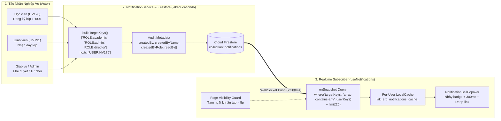

# TÀI LIỆU KIẾN TRÚC: HỆ THỐNG THÔNG BÁO REALTIME TỐI ƯU CHI PHÍ (`onSnapshot` + `targetKeys`) & BẢO MẬT ĐỊNH TUYẾN TẬP TRUNG (`Auth + 6-Role RBAC`)

> **Dự án:** `LAK EDUCATION ERP (lakeducation.com)`  
> **Cơ sở dữ liệu:** Cloud Firestore (`lakeducationdb` — Region `asia-southeast1`)  
> **Phạm vi quy mô:** 700 Học viên + 100 Giáo viên / Giáo vụ / Kế toán / Giám đốc / IT Admin  

---

## 1. Tổng Quan Kiến Trúc Hệ Thống

Hệ thống Thông báo Realtime & Bảo mật Phân quyền Tập trung của **LAK EDUCATION** được thiết kế dựa trên 3 trụ cột cốt lõi:
1. **Nhảy chuông Realtime tức thì (`< 300ms`, Zero-Refresh):** Sử dụng kết nối WebSocket (`onSnapshot`) của Cloud Firestore đẩy trực tiếp sự kiện từ Server xuống chuông thông báo (`NotificationBellPopover`) ngay khi có tương tác nghiệp vụ (Học viên đăng ký lớp, Giáo viên nhận lớp, Giáo vụ phê duyệt/từ chối, Kế toán xác nhận học phí/lương).
2. **Bảo vệ chi phí tuyệt đối (`Indexed TargetKeys + Limit 20`):** Tuyệt đối không quét toàn bộ bảng `notifications`. Mỗi thông báo khi lưu đều được gắn mảng chỉ mục định tuyến `targetKeys` để Firestore lọc trực tiếp trên Server bằng toán tử `array-contains-any` kết hợp `limit(20)` và quản lý vòng đời theo tab (`Page Visibility Lifecycle`).
3. **Truy vết Kiểm toán Toàn diện (`Full Audit Trail`) & Bảo mật Định tuyến Tập trung (`ProtectedRoute 2-Layer Gate`):** Mọi thông báo đều lưu trữ đầy đủ dấu vết người khởi tạo (`createdBy`, `createdByName`, `createdByRole`, `createdAt`, `readBy`, `readAt`) và hiển thị trực quan cho **IT Admin (`ADM001`)** ngay trên danh sách thông báo.



---

## 2. Thiết Kế Chỉ Mục `targetKeys` & Cơ Chế Lọc Server-Side

### 2.1. Quy tắc sinh khóa định tuyến `targetKeys` khi ghi (`sendNotification`)
Mỗi bản ghi trong collection `notifications` tự động tính toán mảng `targetKeys` thông qua [`NotificationService.buildTargetKeys`](file:///Volumes/DATA/projects/ThiEducation/src/core/services/NotificationService.js#L85-L108):

| Kịch bản gửi thông báo | Đầu vào (`recipientId`, `recipientRole`) | Giá trị `targetKeys` lưu trên Firestore | Đối tượng nhận Realtime |
| :--- | :--- | :--- | :--- |
| **Gửi đích danh 1 cá nhân** *(VD: Duyệt học viên `HV176` vào lớp `LH001`)* | `recipientId: 'HV176'`, `recipientRole: 'student'` | `["USER:HV176", "ROLE:student"]` | Học viên `HV176` |
| **Gửi cho bộ phận Giáo vụ điều phối** *(VD: `HV176` đăng ký lớp chờ duyệt)* | `recipientId: null`, `recipientRole: 'academic'` | `["ROLE:academic", "ROLE:director", "ROLE:admin"]` | Toàn bộ Giáo vụ, Giám đốc & IT Admin |
| **Gửi cho toàn bộ 1 vai trò** *(VD: Thông báo lịch họp Giáo viên)* | `recipientId: null`, `recipientRole: 'teacher'` | `["ROLE:teacher"]` | Toàn bộ Giáo viên |
| **Thông báo toàn hệ thống** | `recipientId: null`, `recipientRole: 'all'` | `["ALL"]` | Tất cả người dùng đang đăng nhập |

### 2.2. Truy vấn Realtime không cần Composite Index thủ công
Trong Cloud Firestore, nếu kết hợp `where('targetKeys', 'array-contains-any', ...)` với `orderBy('createdAt', 'desc')`, hệ thống sẽ yêu cầu khởi tạo Composite Index thủ công trên Firebase Console. Để đảm bảo **100% Zero-Config và không bao giờ phát sinh lỗi `failed-precondition`**, [`NotificationService.subscribeToUserNotifications`](file:///Volumes/DATA/projects/ThiEducation/src/core/services/NotificationService.js#L219-L263) sử dụng truy vấn chỉ mục đơn tự động của Firestore:

```javascript
const queryKeys = NotificationService.buildUserQueryKeys(currentUser);
// Ví dụ với Admin ADM001: ['ALL', 'USER:ADM001', 'ROLE:admin', 'ROLE:academic']
// Ví dụ với Học viên HV176: ['ALL', 'USER:HV176', 'ROLE:student']

const q = query(
  collection(db, 'notifications'),
  where('targetKeys', 'array-contains-any', queryKeys),
  limit(maxItems * 2)
);
```
Ngay khi nhận snapshot, client chuẩn hóa `isRead` theo `currentUser.id`, sắp xếp `createdAt` giảm dần và cắt đúng `20` thông báo mới nhất (`DEFAULT_NOTIFICATION_LIMIT = 20`).

---

## 3. Cấu Trúc Dữ Liệu & Hồ Sơ Kiểm Toán (`Notification & Audit Schema`)

Mỗi document trong `notifications/{notiId}` tuân thủ cấu trúc chuẩn sau:

```json
{
  "id": "NOTI-HV176-LH001-PENDING",
  "recipientId": null,
  "recipientRole": "academic",
  "targetKeys": ["ROLE:academic", "ROLE:director", "ROLE:admin"],
  "type": "STUDENT_ENROLL_REQUEST",
  "title": "Học viên đăng ký lớp LH001",
  "message": "Học viên Hoàng Anh (HV176 - hoanganhh3299@gmail.com) vừa đăng ký tham gia lớp Wonders G1 - Class 1A (Sáng T7-CN). Vui lòng xem xét phê duyệt.",
  "actionUrl": "/courses-classes?tab=classes&classId=LH001&action=roster",
  "metadata": {
    "classId": "LH001",
    "className": "Wonders G1 - Class 1A (Sáng T7-CN)",
    "courseId": "CRS001",
    "studentId": "HV176",
    "studentName": "Hoàng Anh",
    "studentEmail": "hoanganhh3299@gmail.com"
  },
  "isRead": false,
  "readBy": ["ADM001"],
  "readAt": "2026-11-11T10:15:00.000Z",
  "createdAt": "2026-11-11T10:12:00.000Z",
  "createdBy": "HV176",
  "createdByName": "Hoàng Anh (hoanganhh3299@gmail.com)",
  "createdByRole": "student",
  "auditTrail": {
    "action": "STUDENT_ENROLL_REQUEST",
    "actorId": "HV176",
    "actorName": "Hoàng Anh (hoanganhh3299@gmail.com)",
    "actorRole": "student",
    "targetKeys": ["ROLE:academic", "ROLE:director", "ROLE:admin"],
    "createdAt": "2026-11-11T10:12:00.000Z"
  }
}
```

### Hiển thị Audit Trail trên Giao diện IT Admin (`NotificationBellPopover.jsx`)
- Khi đăng nhập bằng vai trò **`admin` (`ADM001`)**, mỗi thẻ thông báo trong Popover sẽ hiển thị thêm thanh kiểm toán chuyên biệt (`data-testid="notification-admin-audit"`):
  > 🛡️ `Khởi tạo: Hoàng Anh (HV176) • Đã đọc: 1`
- Đối với các vai trò khác (`director`, `academic`, `teacher`, `accountant`, `student`), thanh kỹ thuật này được ẩn đi để giữ giao diện tinh gọn.

---

## 4. Phân Tích Chi Phí Thực Tế (700 Học Viên + 100 Giáo Viên/Nhân Sự, 20 Thông Báo/Acc/Ngày)

### 4.1. Thông số bài toán
- **Tổng số tài khoản:** `800 users` (`700 Học viên` + `100 Giáo viên, Giáo vụ, Kế toán, Giám đốc, Admin`).
- **Tần suất nhận thông báo:** `20 thông báo / tài khoản / ngày`.
- **Dung lượng trung bình 1 thông báo:** `~380 Bytes` (`0.38 KB`).

### 4.2. Bảng tính toán định mức Cloud Firestore hằng tháng (30 ngày)

| Hạng mục tài nguyên | Khối lượng phát sinh / Ngày | Tổng khối lượng / Tháng (30 ngày) | Hạn mức Miễn phí Firebase (Free Quota) | Chi phí vượt hạn mức (Blaze Plan) |
| :--- | :---: | :---: | :---: | :---: |
| **1. Firestore Reads** *(800 user mở app tải `limit(20)` + nhận `20` sự kiện realtime/ngày)* | `800 × (20 + 20) = 32.000 Reads/ngày` | **`960.000 Reads/tháng`** | `1.500.000 Reads/tháng` *(50.000/ngày)* | **\$0.00 / tháng** *(Nằm gọn trong gói Free!)* |
| **2. Firestore Writes — Kịch bản A** *(Thông báo gộp theo lớp/role + thông báo cá nhân + `writeBatch` đánh dấu đã đọc)* | `~3.000 Writes` tạo mới + `~8.000 Writes` đánh dấu đã đọc = `11.000 Writes/ngày` | **`330.000 Writes/tháng`** | `600.000 Writes/tháng` *(20.000/ngày)* | **\$0.00 / tháng** *(Nằm gọn trong gói Free!)* |
| **3. Firestore Writes — Kịch bản B (Cực đại 1-1)** *(20 thông báo tạo riêng rẽ cho từng người trong 800 người)* | `16.000 Writes` tạo mới + `16.000 Writes` đã đọc = `32.000 Writes/ngày` | **`960.000 Writes/tháng`** | `600.000 Writes/tháng` *(20.000/ngày)* | Vượt `360.000 Writes` × \$0.18/100k = **\$0.65 / tháng (~16.500 VNĐ)** |
| **4. Lưu trữ (Storage) & Băng thông (Network Egress)** | `16.000 × 0.38 KB ≈ 6 MB/ngày` | **`~180 MB Storage`** & **`~360 MB Egress/tháng`** | `1 GB Storage` & `10 GB Egress/tháng` | **\$0.00 / tháng** *(Miễn phí 100%)* |
| **TỔNG CHI PHÍ HẰNG THÁNG** | — | — | — | **\$0.00 – \$0.65 / tháng** *(0đ đến ~16.500đ/tháng)* |

### 4.3. 4 Cơ chế bảo vệ chi phí đã tích hợp trong Code
1. **`where('targetKeys', 'array-contains-any', queryKeys)` + `limit(20)`:** Không bao giờ tải toàn bộ lịch sử thông báo cũ.
2. **Atomic `arrayUnion(currentUser.id)` & Skip-If-Already-Read:** Khi người dùng bấm vào một thông báo đã đọc rồi, hàm `markAsRead` kiểm tra cache và **bỏ qua ngay (`0 Write`)**, không gọi `updateDoc` thừa.
3. **Gom nhóm `writeBatch` khi bấm `"Đã đọc tất cả"` (`markAllAsRead`):** Chỉ cập nhật các thông báo thực sự chưa đọc trong 1 batch duy nhất.
4. **Page Visibility Lifecycle (`useNotifications.js`):** Tự động ngắt kết nối `onSnapshot` khi tab trình duyệt bị ẩn dưới nền quá 5 phút và kết nối lại ngay khi người dùng mở lại tab.

---

## 5. Bảo Mật Định Tuyến Tập Trung (`ProtectedRoute` & `PermissionService`)

1. **Tầng 1 — Chặn Truy Cập Chưa Đăng Nhập (`Unauthenticated Gate`):**
   - Trong [`AuthContext.jsx`](file:///Volumes/DATA/projects/ThiEducation/src/core/context/AuthContext.jsx), khi chưa có phiên đăng nhập hợp lệ trong `localStorage` (`lak_authenticated_user_id`), `currentUser` là `null` (tuyệt đối không tự động fallback vào tài khoản Admin).
   - Trong [`ProtectedRoute.jsx`](file:///Volumes/DATA/projects/ThiEducation/src/core/router/ProtectedRoute.jsx), mọi truy cập trực tiếp qua URL (ví dụ `http://localhost:3000/courses-classes?tab=curriculum`) khi chưa đăng nhập đều bị chặn và chuyển hướng về `/?require_login=true&redirect=...` kèm mở tự động Modal Đăng nhập.
2. **Tầng 2 — Chặn Truy Cập Sai Quyền Vai Trò (`403 Not Found RBAC Gate`):**
   - [`PermissionService.canAccessRoutePath(role, pathname, search)`](file:///Volumes/DATA/projects/ThiEducation/src/core/services/PermissionService.js) kiểm tra quyền truy cập từng đường dẫn và từng trang tạo mới (`/courses-classes/new`, `/curriculum-levels/new`, `/user-management`...).
   - Nếu tài khoản đăng nhập không đủ quyền (ví dụ Học viên `HV176` gõ `/user-management` hoặc `/courses-classes/new`), hệ thống hiển thị màn hình **`403 Not Found`** gọn nhẹ kèm nút **`Quay Lại`**.

---

## 6. Ma Trận Các Trường Hợp Kiểm Thử Tự Động (`E2E Verification Matrix`)

| Mã Test | Kịch bản kiểm thử | Kết quả kỳ vọng |
| :--- | :--- | :--- |
| **TC-01** | Truy cập ẩn danh `/courses-classes?tab=curriculum` khi chưa đăng nhập | Chuyển hướng về `/?require_login=true`, tự động bật Modal Đăng nhập, không lộ dữ liệu nội bộ. |
| **TC-02** | Học viên (`HV176`) truy cập URL trái quyền `/user-management` và `/courses-classes/new` | Chặn đứng và hiển thị màn hình chuẩn **`403 Not Found`**. |
| **TC-03** | Cấu trúc 3 Tab tại `/courses-classes` & 3 Trạng thái đăng ký lớp của Học viên | Tab 1: `Quản Lý Lớp Học & Phân Bổ`; Tab 2: `Danh Mục Khóa Học` (không có nút đăng ký cấp khóa học); Tab 3: `Cấp Độ Giáo Trình`. Trạng thái nút: `Đăng Ký Tham Gia Lớp Học` $\rightarrow$ `Đã đăng ký — Chờ phê duyệt` (disabled, khóa Zoom) $\rightarrow$ `Đã duyệt đăng ký — Đã tham gia lớp học` (mở khóa Zoom). |
| **TC-04** | **Realtime Notification Đa Phiên (`2 Browser Contexts Song Song, Zero F5`):** Học viên `HV176` bấm đăng ký lớp ở Cửa sổ B trong khi Admin `ADM001` đang mở Cửa sổ A | Chuông thông báo của Admin `ADM001` ở Cửa sổ A **tự động nhảy số đỏ Realtime (`< 1s`, không cần F5)**, hiển thị đúng tên `Hoàng Anh (HV176 - hoanganhh3299@gmail.com)` kèm dòng Audit `Khởi tạo: Hoàng Anh (HV176)`. |
| **TC-05** | **Realtime Phê Duyệt & Đánh Dấu Đã Đọc (`Persistence qua F5`):** Admin bấm vào thông báo $\rightarrow$ mở Drawer lớp $\rightarrow$ bấm `"Duyệt Vào Lớp"` $\rightarrow$ Học viên nhận thông báo Realtime | Cửa sổ B của Học viên `HV176` nhảy chuông thông báo `"Phê duyệt tham gia lớp"` ngay lập tức không cần F5; khi bấm `"Đã đọc tất cả"` và F5 tải lại trang, số thông báo chưa đọc giữ nguyên bằng `0`. |

