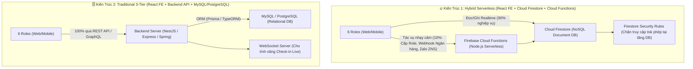
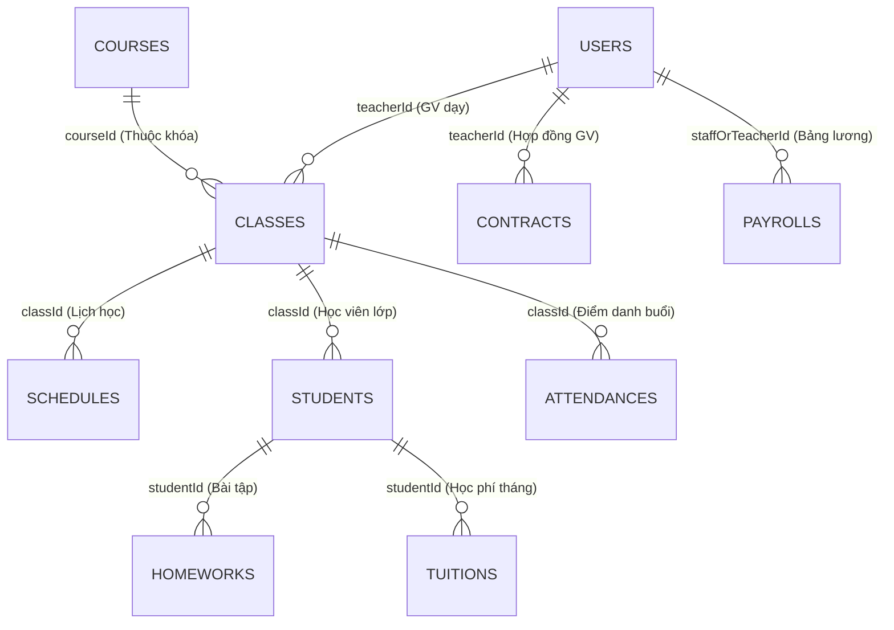

# Chiến Lược Chuyên Sâu: Lựa Chọn Database (`Firestore` vs `MySQL/PostgreSQL`) & Kiến Trúc `Serverless` vs `BE-FE` Cho LAK EDUCATION

> **Tài liệu Phân tích Chiến lược Kỹ thuật (`/boost` Deep-Dive Analysis)**  
> - **Dự án:** **LAK EDUCATION (`lakeducation.com`)**  
> - **Tài khoản Cloud / Firebase chủ quản:** **`vnthietbigarage@gmail.com`**  
> - **Quy mô vận hành:** 520 Học viên, 68 Giáo viên Bản xứ, 28 Lớp Zoom, 6 Roles (`admin`, `director`, `academic`, `teacher`, `accountant`, `student`).

---

## 1. Góc Nhìn Định Lượng (Quantitative Workload & Storage Sizing)

Trước khi chọn Database hay quyết định viết Backend riêng, hãy tính toán chính xác **dung lượng dữ liệu text** và **tần suất đọc/ghi thực tế** của LAK EDUCATION trong 1 tháng và 1 năm:

### 1.1. Ước tính dung lượng Dữ liệu Text (1 năm vận hành)
| Bảng / Collection | Số lượng bản ghi / năm | Kích thước trung bình 1 bản ghi (Text + Metadata) | Tổng dung lượng / năm |
| :--- | :---: | :---: | :---: |
| **1. Hồ sơ Học viên (`students`) & Giáo viên (`teachers`)** | ~`700` hồ sơ | `1.5 KB` / hồ sơ | **`~1.05 MB`** |
| **2. Thời khóa biểu & Ca dạy (`schedules` / `classes`)** | ~`4.000` ca dạy/năm | `0.8 KB` / ca | **`~3.20 MB`** |
| **3. Điểm danh & Nhận xét từng HV (`attendances` + `evaluations`)** | `28 lớp × 12 buổi/tháng × 12 tháng` = `4.032` buổi (~`80.000` lượt nhận xét cá nhân/năm) | `1.2 KB` / nhận xét (gồm 4 điểm sao + đoạn text nhận xét tiếng Anh 50–100 từ) | **`~96.00 MB`** |
| **4. Bài tập về nhà (`homeworks`)** | ~`25.000` lượt giao & nộp bài/năm | `1.0 KB` / bài (text đề bài + link bài làm + nhận xét GV) | **`~25.00 MB`** |
| **5. Tài chính: Hợp đồng, Lương GV/Giáo vụ, Học phí (`contracts`, `payrolls`, `tuitions`)** | `520 HV × 12 tháng` + `76 bảng lương × 12 tháng` = `~7.200` bản ghi/năm | `1.0 KB` / bản ghi | **`~7.20 MB`** |
| **6. Nhật ký Hệ thống & Audit Logs (`system_logs`)** | ~`30.000` logs/năm | `0.5 KB` / log | **`~15.00 MB`** |
| **TỔNG DỮ LIỆU TEXT 1 NĂM** | **~`147.000` bản ghi/năm** | — | **Chỉ `~147.5 MB / năm`!** |

> 💡 **Nhận định cốt lõi số 1:** Toàn bộ dữ liệu chữ (Text), điểm số, nhận xét giáo viên, hợp đồng, bảng lương và học phí của cả trung tâm trong **suốt 5 năm liên tục** chỉ nặng khoảng **`700 MB`** (nhỏ hơn 1 bộ phim HD và nằm gọn trong ngưỡng **Miễn phí 1 GB (`1.024 MB`)** của Cloud Firestore trên tài khoản `vnthietbigarage@gmail.com`).

---

## 2. Đa Chiều Góc Nhìn: `Firebase Firestore` vs `MySQL / PostgreSQL`

### 2.1. Phân tích Ưu / Nhược điểm dưới 4 Góc nhìn Chuyên gia

| Góc nhìn đánh giá | 🔥 Phương án 1: Cloud Firestore + Cloud Functions | 🗄️ Phương án 2: Backend Riêng + MySQL / PostgreSQL |
| :--- | :--- | :--- |
| **1. Góc nhìn Vận hành Đào tạo (Giáo vụ & Giáo viên Bản xứ)** | **Thắng tuyệt đối:** • Khi Giáo viên ở Mỹ/Anh bấm nút **`Check-in Lớp học`** hoặc lưu nhận xét, cơ chế `onSnapshot` của Firestore đẩy trạng thái về màn hình của **Giáo vụ** và **Phụ huynh** trong **`0.2 giây`** mà không cần bấm F5. • Lưu trữ linh hoạt danh sách điểm 4 kỹ năng + nhận xét từng học viên dưới dạng mảng/sub-collection cực kỳ tự nhiên. | **Phức tạp hơn nhiều:** • Muốn màn hình Giáo vụ tự nhảy trạng thái khi GV Check-in, bạn phải dựng thêm WebSocket/Socket.io hoặc bắt trình duyệt gọi API liên tục mỗi 5 giây (Polling). • Mỗi lần thêm tiêu chí chấm điểm mới (ví dụ thêm kỹ năng *Grammar*), phải chạy migration sửa bảng SQL. |
| **2. Góc nhìn Tài chính & Kế toán (Director & Kế toán)** | **Cần thiết kế khéo (Điểm yếu của NoSQL nếu dùng sai):** • Firestore không có câu lệnh `SELECT SUM(amountDue) FROM tuitions` miễn phí (nếu quét 520 học viên mỗi lần mở Dashboard sẽ tốn 520 lượt đọc). • **Giải pháp chuẩn:** Dùng **Firestore Transaction + Document Tổng hợp (`monthly_stats/2026-08`)**. Mỗi khi Kế toán bấm *"Xác nhận Đã Thu"*, Transaction vừa đổi trạng thái học viên sang `PAID`, vừa cộng dồn số tiền vào `monthly_stats`. Khi Director mở Dashboard chỉ tốn **đúng 1 lượt đọc**! | **Thế mạnh tự nhiên của SQL:** • Có sẵn `SUM()`, `GROUP BY`, `JOIN` giữa bảng Học phí, Lớp học, Giáo viên. • Ràng buộc khóa ngoại (`Foreign Key`) và ACID Transaction truyền thống rất quen thuộc với các phần mềm kế toán lớn. |
| **3. Góc nhìn Bảo mật 6 Roles (IT Admin)** | **Bảo mật trực tiếp tại Database (`Firestore Security Rules`):** • Không cần viết 50 API Middleware. Bạn viết 1 file `firestore.rules` gắn thẳng lên tài khoản `vnthietbigarage@gmail.com` để ép cứng: `student` chỉ đọc được document có `studentId == auth.uid`; chỉ `director` và `accountant` mới được ghi vào bảng `payrolls`. | **Bảo mật tại tầng Backend API:** • An toàn cao vì trình duyệt không bao giờ chạm trực tiếp vào MySQL, nhưng đổi lại bạn phải tự code toàn bộ hệ thống Auth JWT, Role Guard Middleware và viết hàng chục API endpoints. |
| **4. Góc nhìn Chi phí & Nhân sự Bảo trì (3 năm)** | • **Chi phí hạ tầng:** **0đ – 50.000đ/tháng** (nằm trong Free Tier của Firebase). • **Nhân sự:** Chỉ cần **1 Developer (hoặc bạn + AI Agent)** quản lý duy nhất 1 codebase React + Firebase. Không bao giờ lo sập VPS lúc nửa đêm. | • **Chi phí hạ tầng:** **500.000đ – 1.500.000đ/tháng** (VPS Backend + Managed MySQL + Backup). • **Nhân sự:** Phải duy trì **2 codebase** (1 repo Frontend + 1 repo Backend), tự lo vá lỗi bảo mật Linux, cấu hình Nginx, SSL, backup MySQL hàng ngày. |

---

## 3. Trả Lời Câu Hỏi Cốt Lõi: "Có Nên Làm BE Riêng Hay Chỉ Cần Dùng Firebase?"

### ✅ Câu trả lời dứt khoát cho LAK EDUCATION:
> **Giai đoạn hiện tại (Từ 500 $\rightarrow$ 3.000 học viên): TUYỆT ĐỐI KHÔNG NÊN dựng Backend Server + MySQL riêng. Hãy dùng kiến trúc "90% Firebase Direct (Firestore + Auth) + 10% Firebase Cloud Functions".**

Tại sao không dùng "100% chỉ Frontend", mà là **"90% Firestore Direct + 10% Cloud Functions"**?
Vì trong hệ thống 6 Roles của bạn có những tác vụ mà **trình duyệt (Frontend) có thể làm thẳng**, và có những tác vụ **bắt buộc phải chạy ngầm ở phía Server (Serverless Function)** để đảm bảo an toàn tuyệt đối:

1. **90% Tác vụ chạy thẳng từ React Service Class $\rightarrow$ Cloud Firestore (Không cần BE):**
   * Xem Dashboard, lọc Thời khóa biểu, Giáo vụ tạo Khóa học/Xếp lịch, Giáo viên bấm Check-in lớp học, Giáo viên điểm danh & viết nhận xét Text cho học viên, Học viên nộp bài tập, Kế toán bấm duyệt/xác nhận trên giao diện.
   * Tất cả đều được bảo vệ bởi **Firestore Security Rules** theo đúng 6 Roles.
2. **10% Tác vụ dùng `Firebase Cloud Functions` (Đóng vai trò như Backend mini không cần thuê Server):**
   * **Cấp quyền 6 Roles (`admin` IT):** Khi IT Admin tạo tài khoản mới và gán quyền `director` hoặc `accountant`, Cloud Function sẽ gắn `Custom Claims` vào token đăng nhập.
   * **Tích hợp bên thứ 3 cần giấu API Secret Key:** Gửi tin nhắn Zalo ZNS / SMS nhắc học phí tự động, tự động tạo link phòng học qua Zoom API, hoặc nhận Webhook từ ngân hàng (Casso/SePay) khi phụ huynh chuyển khoản học phí.

---

## 4. Thiết Kế Cấu Trúc Dữ Liệu Chuẩn Trên Cloud Firestore (`vnthietbigarage@gmail.com`)

Để lưu trữ toàn bộ dữ liệu Text và nghiệp vụ của 5 phân hệ mà **tiết kiệm lượt đọc nhất** và **truy vấn nhanh nhất**, cấu trúc trên Firestore được chia thành **8 Collections gốc**:

### Chi tiết nơi lưu từng loại dữ liệu Text:
1. **`users/{userId}`**: Lưu thông tin đăng nhập, `role` (`admin` | `director` | `academic` | `teacher` | `accountant` | `student`), `name`, `email`, `phone`.
2. **`courses/{courseId}`**: Lưu tên khóa học, cấp độ (`level`), học phí chuẩn/tháng, tổng số lớp đang mở.
3. **`classes/{classId}`**: Lưu thông tin lớp Zoom (`meetingId`, `passcode`, `meetingLink`), `teacherId`, trạng thái vận hành (`operationStatus`), trạng thái `checkInStatus`.
4. **`schedules/{slotId}`**: Lưu thứ, khung giờ, `classId`, `teacherId`, trạng thái ca dạy (`UPCOMING`, `CHECKED_IN`, `COMPLETED`).
5. **`students/{studentId}`**: Lưu hồ sơ học viên, tên tiếng Anh, thông tin phụ huynh, điểm trung bình 4 kỹ năng và **đoạn text nhận xét mới nhất (`latestTeacherNote`)** để hiển thị tức thì trên Dashboard mà không cần join bảng.
6. **`attendances/{attendanceId}`**: Lưu kết quả từng buổi học, link video (`recordingUrl`), **đoạn text nhận xét chung buổi học (`teacherFeedback`)** và mảng điểm danh chi tiết của từng học viên trong buổi đó.
7. **`homeworks/{homeworkId}`**: Lưu tiêu đề & **nội dung đề bài tập bằng text**, hạn nộp, link file bài làm của học viên, điểm số và **text nhận xét sửa bài của giáo viên**.
8. **`finances_contracts/{id}`, `finances_payrolls/{id}`, `finances_tuitions/{id}` + `monthly_stats/{YYYY-MM}`**:
   * Lưu hợp đồng, bảng lương GV, bảng lương Giáo vụ, hóa đơn học phí từng tháng.
   * Riêng `monthly_stats/{YYYY-MM}` lưu sẵn tổng tiền đã thu, tổng nợ, tổng quỹ lương để `director` và `accountant` mở Dashboard trong `1 lượt đọc` duy nhất.

---

## 5. Lộ Trình Triển Khai Thông Minh Nhờ Kiến Trúc `BaseModuleService` Đã Có

Nhờ chúng ta đã thiết kế sẵn [`BaseModuleService.js`](file:///Volumes/DATA/projects/ThiEducation/src/shared/services/BaseModuleService.js) và **16 Class Nghiệp vụ độc lập**, bạn không bao giờ bị "khóa chặt" (Vendor Lock-in). Bạn có thể đi theo lộ trình 3 bước cực kỳ an toàn:

* **Bước 1 (Làm ngay lập tức trong 5 phút):** Bật chế độ **Lưu trữ bền vững trên `localStorage` (`StorageAdapter`)** ngay trong `BaseModuleService` $\rightarrow$ Bạn và đội ngũ test trực tiếp trên web, tạo hợp đồng, duyệt lương, xếp lịch, điểm danh, thu học phí, **bấm F5 thoải mái không mất dữ liệu** (có nút *"Khôi phục dữ liệu mẫu gốc"* bất cứ lúc nào).
* **Bước 2 (Khi đưa lên `lakeducation.com`):** Tạo Project `lakeducation-app` trong Firebase Console của tài khoản **`vnthietbigarage@gmail.com`**, dán `firebaseConfig` thật vào [`src/core/services/firebase.js`](file:///Volumes/DATA/projects/ThiEducation/src/core/services/firebase.js) và bật `IS_FIREBASE_ENABLED = true` để đồng bộ toàn bộ 8 Collections lên Cloud Firestore.
* **Bước 3 (Tương lai xa > 10.000 học viên):** Nếu sau này muốn chuyển sang PostgreSQL/MySQL riêng, chỉ cần viết lại `StorageAdapter` gọi REST API mà giữ nguyên 100% 16 Class nghiệp vụ và toàn bộ giao diện React.

