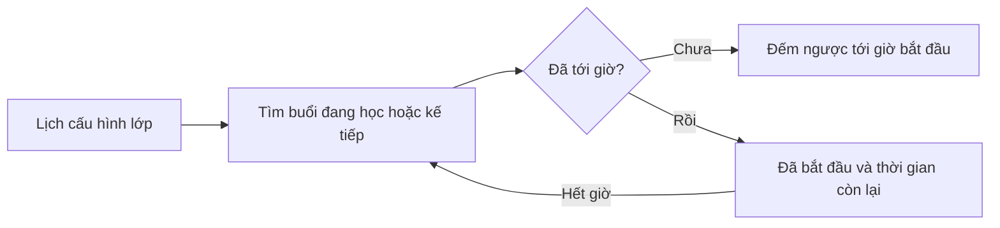

# Bộ đếm thời gian trên card lớp Dashboard

## Phạm vi và người dùng
Card lớp hiện có của Giáo vụ và Giáo viên tại `/dashboard`. Giữ nguyên phạm vi lớp và quyền truy cập hiện hành.

## Quy tắc nghiệp vụ
- Dựa trên lịch tuần, giờ vào/tan lớp, ngày khai giảng/kết thúc và các giai đoạn `scheduleHistory` của lớp.
- Giờ lưu trữ mặc định Việt Nam GMT+7; khoảng thời gian hiển thị độc lập múi giờ thiết bị.
- Trước buổi: đếm ngày, giờ, phút, giây tới buổi gần nhất.
- Trong buổi: hiển thị thời gian đã bắt đầu và còn lại, cập nhật mỗi giây.
- Kết thúc buổi: chuyển tới buổi kế tiếp; hết khóa/tạm hoãn/thiếu lịch hợp lệ: ẩn bộ đếm.
- Không tự suy diễn giờ khi thiếu cấu hình. Không ghi dữ liệu hay đăng ký listener Firestore mới.
- EN/VI dùng nhãn trong hai từ điển trung tâm. Đồng hồ chung tự dọn khi không còn card.

## Tiêu chí nghiệm thu và kiểm thử
- T01: Đếm trước giờ chính xác tới giây, kể cả trên một ngày.
- T02: Tự chuyển sang đang học ở đúng giờ bắt đầu và buổi kế tiếp ở đúng giờ kết thúc.
- T03: Áp dụng lịch tuần, biên ngày khai giảng/kết thúc, lịch qua đêm và lịch sử thay đổi.
- T04: Không bịa giờ khi thiếu cấu hình; không hiện timer cho lớp hoàn thành/tạm hoãn.
- T05: EN/VI đúng nhãn; Desktop 1366px/Mobile 390px, timer không gây tràn ngang.
- T06: Reload/tạm ẩn tab rồi trở lại tính từ thời gian hiện tại, không cộng dồn sai lệch.
- T07: Không đổi quyền, dữ liệu lớp, đăng ký hay thông tin phòng học. Không có migration.

Regression: `scripts/test_dashboard_class_timer.mjs`; bằng chứng giao diện trong `test-results/dashboard-class-timer/` khi chạy kiểm thử trình duyệt.

## Phạm vi tệp
- `src/modules/dashboard/components/ClassLiveCard.jsx`: gắn timer, đồng bộ trạng thái, cho phép nhãn xuống dòng.
- `src/modules/dashboard/components/ClassSessionTimer.jsx`: giao diện bộ đếm.
- `src/modules/dashboard/hooks/useClassTimer.js`: đồng hồ chung một giây.
- `src/modules/dashboard/services/ClassTimerService.js`: service riêng cho bộ đếm.
- `src/modules/dashboard/utils/classSessionTimer.js`: tìm buổi hợp lệ và tính khoảng thời gian.
- `src/modules/dashboard/utils/classTimeUtils.js`: nhận thêm session tùy chọn để trạng thái card khớp timer; giữ hành vi cũ cho các caller không truyền session.
- `src/core/i18n/locales/en.js`, `vi.js`: nhãn timer song ngữ.
- `scripts/test_dashboard_class_timer.mjs`, `scripts/test_dashboard_class_timer_ui.py`: regression tính toán và giao diện.
- Tài liệu này; `package.json` được script build tăng version tự động.

## Phạm vi xác minh
Kiểm thử component thật với dữ liệu tiền tố `[TEST:dashboard-class-timer:20261113]` chỉ trong bộ nhớ trình duyệt, không tạo tài khoản hoặc bản ghi Firestore. Đã đóng context sau mỗi ca. Kiểm thử bao gồm 1366px VI, 390px VI/EN, múi giờ New York, chuyển mốc từng giây, buổi kế tiếp, reload và không tràn ngang. Không thay đổi nghiệp vụ/module khác; chưa nghiệm thu lại toàn bộ Dashboard với phiên đăng nhập thật và Firestore.
