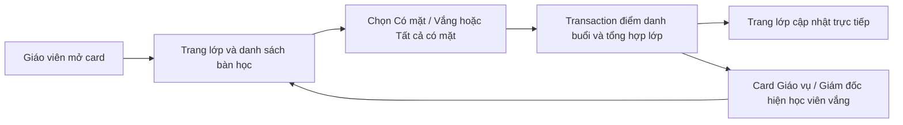

# Trang chi tiết lớp và điểm danh trực tiếp

## Mục tiêu và phạm vi
Trang `/classroom/:classId` thay cho modal chi tiết từ card Dashboard. Giáo viên phụ trách điểm danh; giáo vụ, giám đốc và IT theo dõi. Không tự suy luận kết nối mạng, Zoom, camera hoặc thiết bị của học viên.

## Quy tắc nghiệp vụ
- Mỗi học viên trong `class.studentIds` là một bàn: avatar thật (hoặc chữ đầu tên), máy tính và trạng thái UNMARKED/ONLINE/OFFLINE.
- ONLINE = giáo viên xác nhận có mặt; OFFLINE = giáo viên xác nhận vắng. UNMARKED không tính là vắng.
- Giáo viên chỉ được sửa lớp mình phụ trách trong buổi đang diễn ra. Người theo dõi không chỉnh điểm danh.
- Nút Tất cả có mặt cập nhật toàn bộ danh sách hiện tại trong một transaction. Có thể sửa riêng từng học viên sau đó.
- Bản ghi theo `classId + thời điểm bắt đầu buổi` trong `session_evaluations`; lịch sử các buổi không ghi đè lẫn nhau.
- Transaction đọc lại lớp và bản điểm danh trước khi cập nhật; chỉ thay đổi trạng thái cần thiết, bảo toàn nhận xét/điểm đã có. Lưu actor và thời gian cập nhật.
- Cập nhật tổng hợp `classroom_live/{classId}` trong cùng transaction để card và trang chi tiết cùng nguồn dữ liệu. Tách khỏi `classes` để học viên đọc lớp không nhận được điểm danh của người khác.
- `onSnapshot` giới hạn theo document lớp/buổi; Dashboard dùng danh sách lớp sẵn có với listener theo role, không polling.
- Lỗi lưu phải hiển thị, hoàn tác UI lạc quan; lỗi listener phải hiển thị và khóa ghi. Đổi lớp/buổi phải hủy listener cũ và xóa state.
- Thông tin phòng học chỉ dùng dữ liệu thật, không chèn ID/mật khẩu giả. Các liên kết giữ nguyên nghiệp vụ.

## Tác động và kiến trúc
Module mới `classroom` độc lập với page/components/hooks/services/models, public entry qua index. Shared service/hook/model dùng chung giữa classroom và dashboard; tiện ích session dùng chung với timer. Router App/ERP và PermissionService bổ sung quyền trang lớp. Không sửa học phí, lương, đăng ký lớp hay tạo khóa học. Không deploy/ghi Production.

## Test plan trước triển khai
| ID | Ca kiểm tra |
| --- | --- |
| C01 | Click card mở URL trang riêng; reload giữ đúng lớp |
| C02 | Avatar, tên thật từ hồ sơ và máy tính; không có dữ liệu giả khi rỗng |
| C03 | Giáo viên đổi ONLINE/OFFLINE, cập nhật ngay, rollback khi lỗi |
| C04 | Tất cả có mặt, sửa lại một học viên vắng; không mất nhận xét/điểm |
| C05 | Hai context giáo viên/giáo vụ: cập nhật không F5, card có tên vắng |
| C06 | Giám đốc xem được, không chỉnh; giáo viên khác/học viên/ẩn danh bị chặn |
| C07 | Qua buổi mới, đổi lịch và qua ngày: không mang điểm danh buổi cũ |
| C08 | EN/VI, desktop/mobile, không tràn ngang và vùng chạm 44px |
| C09 | Transaction đồng thời không ghi đè học viên khác; lỗi quyền/listener hiển thị |
| C10 | Emulator teardown, build cả Landing/ERP, không ghi dữ liệu PROD |

## An toàn phát hành
Repository hiện chưa quản lý Firestore Rules cho dữ liệu đang chạy. Rules bổ sung cần ghép với rules thật trước khi phát hành; không thay thế hoặc deploy toàn bộ rules hiện hữu. Quyền server cần profile ID đã xác thực (`profileId` custom claim hoặc document users có ID bằng auth.uid). Đây là điều kiện nghiệm thu Production, không được thay bằng xác thực localStorage.

Bản để rà soát: `docs/features/classroom-rules-fragment.rules`. Bộ rules trong `tests/classroom/` chỉ dùng Emulator, có ngoại lệ đọc danh bạ fixture để tương thích luồng login hiện tại, tuyệt đối không deploy lên cloud. Roster user đọc theo quyền hồ sơ hiện hành; khi ghép rules phải bảo đảm giáo viên chỉ đọc hồ sơ học viên thuộc lớp mình. Chưa xác minh rules đang triển khai trên DEV/PROD và chưa thay đổi custom claims thật.

Thông báo vắng: Giáo vụ/Giám đốc/Admin có nút nhắc giáo viên trong trang chi tiết. Thông báo chỉ có `USER:<teacherId>`, kèm audit/deep-link, mỗi buổi và mỗi tập học viên vắng chỉ gửi một lần. Không gửi tự động theo nhịp timer và không gửi SMS/email.

## Biên bản QC local
- Phiên bản: `Version 1.2.49 • build 2026111307v`.
- `node scripts/test_classroom_model.mjs`: PASS trạng thái/biên buổi mới, phân quyền, ca âm.
- `node scripts/test_dashboard_class_timer.mjs`: PASS regression timer sau khi chuyển utility/đồng hồ sang shared.
- `python3 scripts/test_classroom_e2e.py`: PASS giao diện thật 1366px VI và 390px EN trên Firebase Emulator: mở trang từ card, online/offline, tất cả có mặt, hai context realtime, F5, thông báo đúng giáo viên/không lộ giáo viên khác/ngăn gửi trùng, giao dịch đồng thời, giữ nhận xét và điểm cũ, server từ chối sai quyền, hoàn tác khi không lưu được.
- Tiền tố fixture: `[TEST:classroom:20261113]`; teardown xác minh 0 bản ghi thử trong users/classes/classroom_live/session_evaluations/notifications và xóa tài khoản Auth đã tạo.
- Ảnh: `test-results/live-classroom-attendance/teacher-desktop.png`, `teacher-mobile-en.png`, `academic-dashboard.png`.
- Build Landing + ERP: PASS. Cảnh báo kích thước bundle hiện có vẫn còn.
- Không thay đổi dữ liệu thật; chưa nghiệm thu với tài khoản thật trên DEV/PROD. Rules và ánh xạ danh tính thật là cổng kiểm tra bắt buộc trước phát hành.

## Tệp thay đổi trong tác vụ
- Module mới `src/modules/classroom/`: index, page, model, controller hook, services (ClassroomService, ClassroomNoticeService), components (StudentSeat, ClassroomSeating, ClassroomInfo, ClassroomReminder), CSS.
- Shared mới: `models/classroom.model.js`, `services/ClassroomRealtimeService.js`, `hooks/useClassroomClock.js`, `utils/classSessionUtils.js`, `components/ClassAttendanceSummary.jsx`.
- Dashboard: `DashboardPage.jsx`, `hooks/useDashboardController.js`, `hooks/useDashboardClassroom.js`, `hooks/useClassTimer.js`, `components/ClassLiveCard.jsx`, `ClassCardActions.jsx`, `ClassMonitoringPanel.jsx`, `AcademicOperationsPanel.jsx`, `TeacherWorkspacePanel.jsx`, `utils/classSessionTimer.js`.
- Routing: `src/App.jsx`, `src/ErpApp.jsx`; RBAC: `src/core/services/PermissionService.js`; nhãn: hai locale `en.js`/`vi.js`.
- `src/modules/attendance/components/SessionEvaluationTable.jsx`: bản điểm danh mới chưa chấm kỹ năng hiển thị dấu gạch, tránh tự hiển thị điểm 5 giả.
- Test: `scripts/classroom_test_fixture.py`, `test_classroom_e2e.py`, `test_classroom_model.mjs`, `tests/classroom/firebase.json`, `tests/classroom/firestore.rules`.
- Tài liệu này, fragment rules; `package.json` chỉ tăng version/build bằng script chuẩn.

Phần ngoài phạm vi không được sửa: học phí, lương, hợp đồng, đăng ký/phê duyệt lớp, hồ sơ và dữ liệu tài khoản thật. Các thay đổi có sẵn trong worktree được giữ nguyên.
